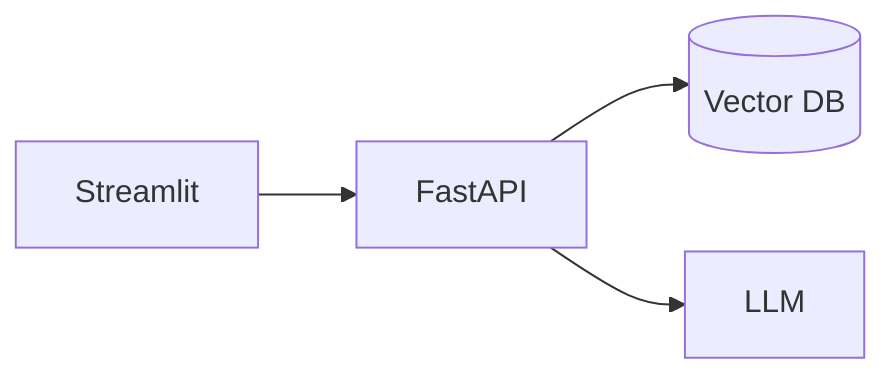

# Day 48 · Task 1 · Build: chat-with-docs v2

> Combine the week, then fill the results table and README.

## Part 1: README

# Chat with your docs

## Architecture

## How to run

## Example questions and answers

## What I'd improve

## Part 2: Report

## Results
| Setup | Faithfulness | Answer relevancy | Context recall |
|-------|-----|-----|-----|
| Vector only | | | |
| Hybrid | | | |
| Hybrid + rerank | | | |

Biggest improvement came from:
