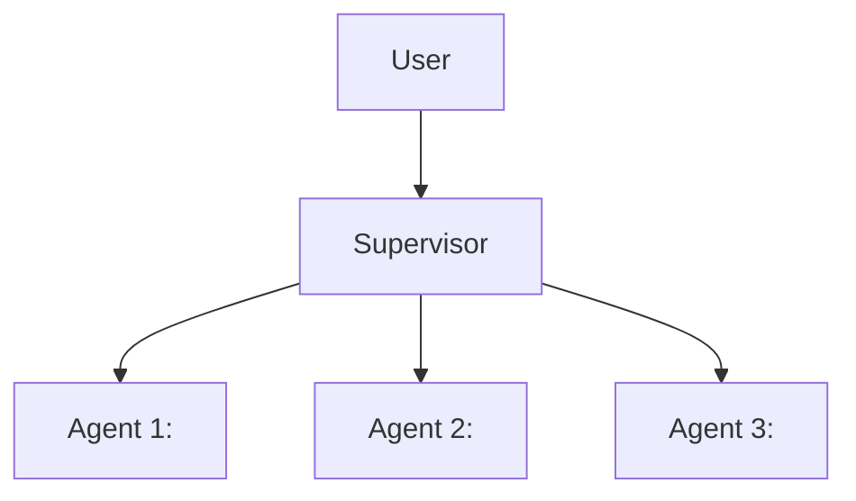

# Day 59 · Task 2 · AI & ML: Design a 3-agent system

> Sketch a 3-agent system for a business process you know.

## Design: 3-agent system for ________ (a business process you know)

- Each agent's tools:
- What needs human approval:
- How results are combined:
