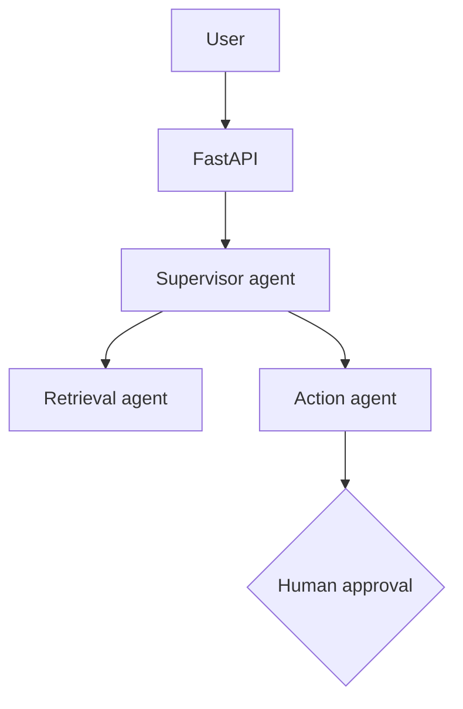

# Day 79 · Task 1 · Engineering: Requirements & architecture

> Users, data sources, actions needing approval, success metrics. Then: Agents, tools, data stores, deployment.

## Part 1: Requirements

## Requirements
- Data sources:
- Actions the system can take:
- Actions needing human approval:
- Success metrics (e.g. 80% tickets resolved, <5s latency):

## Part 2: Architecture

## Architecture

